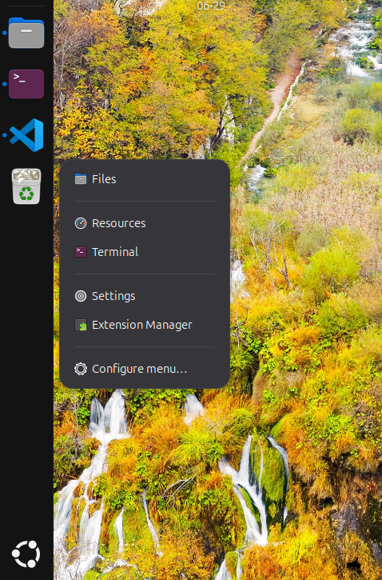

# Dock Right-Click Menu

A GNOME Shell extension that gives the **Ubuntu Dock** a right-click menu on its empty space.
You choose the apps, and can group them with separators and one level of submenus.

<p align="center">
  
</p>

By default, right-clicking the gap between or below the dock icons does nothing. With this
extension it opens a menu of your own apps, grouped with separators, plus an optional
*Configure menu…* entry.

Right-clicking an app icon, the *Show Apps* button or the trash still opens the dock's own menu.

## Features

- Menu of any installed apps, with their icons.
- Separators, and submenus one level deep.
- Graphical editor: searchable app picker, reorder, remove, rename submenus.
- Opens a new window, or focuses the app if it is already running (your choice).
- Edits apply immediately; no restart needed.
- Works with the dock on any screen edge. Handles apps that were uninstalled since you added them.
- Translations: Polish, Ukrainian (see [Translating](#translating)).

## Compatibility

| Item | Supported |
|---|---|
| GNOME Shell | 49, 50 (Ubuntu 26.04 LTS ships 50) |
| Dock | Ubuntu Dock, Dash to Dock (both use the actor name `dashtodockContainer`) |
| Session | Wayland and X11 |

Other docks (Dash to Panel, Dock from Dash, ...) are not detected.

## Installation

### From a release zip

```bash
gnome-extensions install --force dock-right-click-menu@jod.local.v1.1.1.zip
```

GNOME Shell only discovers new extensions at start-up, and on Wayland it cannot be restarted in
place: **log out and back in once**, then:

```bash
gnome-extensions enable dock-right-click-menu@jod.local
```

### From source

```bash
git clone https://github.com/jackal-kr/dock-right-click-menu.git
cd dock-right-click-menu
make install        # builds dist/*.zip and runs gnome-extensions install
```

`make build` needs `glib-compile-schemas` (package `libglib2.0-bin`) and `msgfmt` (package
`gettext`).

## Usage

1. Open the settings: `gnome-extensions prefs dock-right-click-menu@jod.local`, or use the
   *Extensions* app.
2. On the **Menu** page, press *Add application*, *Add separator* or *Add submenu*.
   Use the arrows to reorder and the bin to remove. A submenu is expanded to edit its title and
   contents.
3. Right-click empty space on the dock.

While the menu is empty, right-click shows a single *Configure menu…* entry. The
**General** page can keep that entry visible permanently and sets the launch behaviour.

## Configuration

Everything is editable in the preferences window. The settings live in the schema
`org.gnome.shell.extensions.dock-right-click-menu`:

| Key | Type | Default | Meaning |
|---|---|---|---|
| `items` | string (JSON) | `[]` | The menu definition, see below |
| `launch-mode` | enum | `new-window` | `new-window` or `focus-or-launch` |
| `show-settings-item` | boolean | `false` | Append *Configure menu…* to the menu |

`items` holds a JSON list, which you can also edit with `dconf-editor`:

```json
[
  {"type": "app", "id": "org.gnome.Terminal.desktop"},
  {"type": "separator"},
  {"type": "submenu", "title": "Office", "children": [
    {"type": "app", "id": "libreoffice-writer.desktop"},
    {"type": "separator"},
    {"type": "app", "id": "libreoffice-calc.desktop"}
  ]}
]
```

A submenu may contain only apps and separators. Invalid entries are ignored.

## How it works

The extension listens to the stage's `captured-event` signal, so it does not patch the dock.
On a secondary-button press it checks which actor is under the pointer: if it is inside the dock
(actor `dashtodockContainer`) but not inside an icon slot, the press is swallowed and, on button
release, a `PopupMenu` anchored to the dock's edge is shown.

| File | Role |
|---|---|
| `extension.js` | Entry point; wires the pieces together |
| `lib/dockClick.js` | Detects a right-click on empty dock space |
| `lib/dockMenu.js` | Builds and shows the popup menu, launches apps |
| `lib/menuModel.js` | Parses, validates and resolves the stored menu. No GNOME imports, unit tested |
| `lib/constants.js` | Settings keys and enums shared with the preferences |
| `prefs.js`, `preferences/*.js` | Preferences window: Menu, General and About pages, app chooser |

## Troubleshooting

**The extension is installed but `enable` says it does not exist.** The shell has not been
restarted since the install. Log out and in, or test with `make nested`.

**Nothing happens on right-click.** Check the extension state and the log:

```bash
gnome-extensions info dock-right-click-menu@jod.local     # State should be ACTIVE
journalctl -b -o cat /usr/bin/gnome-shell | grep -i dock-right-click
```

If the state is `ACTIVE` and there are no errors, verify the dock's actor name in Looking Glass
(`Alt+F2`, `lg`):

```js
Main.layoutManager.uiGroup.get_children().filter(a => /dock|dash/i.test(a.name)).map(a => a.name)
```

It should include `dashtodockContainer`. If it does not, open an issue with the output.

**My code changes are not picked up.** GNOME Shell caches extension modules until the next
login. Use `make nested` to test changes without logging out (needs the `mutter-dev-bin` package).

**"See Details" in the Extensions app shows an error.** That page fetches data from
extensions.gnome.org and has nothing to show for an extension that is not published there.

## Development

```text
dock-right-click-menu/
├── dock-right-click-menu@jod.local/   the extension (this folder is what gets zipped)
│   ├── metadata.json
│   ├── extension.js, prefs.js
│   ├── lib/                           shell-side code and the shared data model
│   ├── preferences/                   preferences pages
│   ├── schemas/                       GSettings schema
│   └── locale/                        compiled translations (generated, not tracked)
├── po/                                translation template and catalogs
├── docs/                              DEVELOPMENT.md guide, screenshot used by the README
├── scripts/check-env.sh               `make doctor`
├── tests/                             Node.js unit tests for lib/menuModel.js
├── .vscode/                           VS Code settings, tasks and recommended extensions
├── .github/workflows/ci.yml           lint, tests and zip build on every push
├── Makefile, package.json, eslint.config.js
├── README.md, CHANGELOG.md, LICENSE
```

**Full setup guide (packages, VS Code, nested shell, checklist, troubleshooting):
[docs/DEVELOPMENT.md](docs/DEVELOPMENT.md).** The short version:

```bash
sudo apt install git make zip gettext libglib2.0-bin nodejs npm gnome-shell mutter-dev-bin dbus-daemon
npm install       # once, for ESLint
make doctor       # checks the machine, tells you what is missing
make test         # unit tests, plain Node.js, no GNOME needed
make lint
make link         # once; then log out and in once
make nested       # throw-away GNOME Shell window that loads your current code
```

Edits to `extension.js` and `lib/` are picked up each time `make nested` is started (no logout).
The repository ships a VS Code workspace: open the folder, accept the recommended extensions,
and run the tasks from *Terminal ▸ Run Task…* (Check environment, Test, Lint, Build zip, Link for
development, Install zip, Nested shell, Shell log, Update translations). ESLint fixes on save, and
`npm install` also fetches the GNOME Shell type definitions used for IntelliSense.

Guidelines used here, in line with the
[GNOME Shell extension review guidelines](https://gjs.guide/extensions/review-guidelines/review-guidelines.html):
no `gi://` imports of `Gtk`/`Adw`/`Gdk` in shell-side code or of `Clutter`/`Shell`/`St` in
preferences code, everything created in `enable()` is destroyed in `disable()`, no
subprocesses, no network access.

Debugging in the running shell: `Alt+F2`, `lg`, then use the *Evaluator*; logs go to
`journalctl -f -o cat /usr/bin/gnome-shell`.

## Translating

```bash
make pot                              # refresh po/dock-right-click-menu.pot and update the catalogs
msginit -i po/dock-right-click-menu.pot -l de -o po/de.po   # start a new language
make build                            # compile; the zip picks the .mo files up
```

The Polish and Ukrainian catalogs are a first draft; corrections are welcome.

## Releasing

1. Update `CHANGELOG.md`; bump `version` and `version-name` in `metadata.json`.
2. `make test lint zip`.
3. Upload `dist/*.zip` to <https://extensions.gnome.org/upload/>.

## License

GPL-3.0-or-later, see [LICENSE](LICENSE). Copyright © 2026 JOD (Oleksiy Degtyar).
